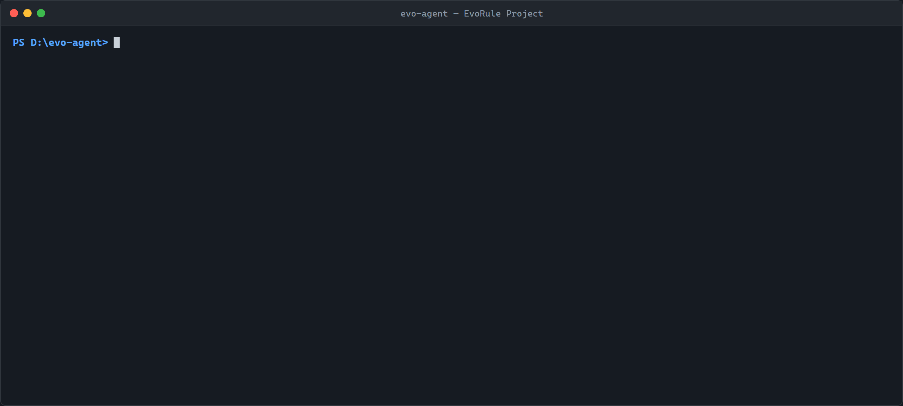

# Evo-Agent

**Evo-Agent — a trustworthy AI workstation**: rule-constrained AI Agent orchestration on top of the evorule deterministic execution engine, where every execution leaves an auditable Fact chain.

[![CI][badge-ci]][ci] [![License][badge-license]][license-file]

---

## Positioning

**Evo-Agent = LLM brain + tool hands + persistent memory + rule constraints; the execution process leaves an auditable Fact chain through the evorule engine.**

It does not reinvent state machines, and it does not embed an LLM client. All LLM calls, tool calls, and memory reads/writes become evorule `IoRequest` events; the evorule reactor handles execution, rollback, and audit — the agent layer only decides "what to do next". Mechanism and application stay in separate processes talking over a single HTTP contract, so the determinism / auditability boundary is never polluted by business logic.

### Three AI roles

| Role | Description | Agents |
|------|-------------|--------|
| **Rule-creation assistant** | natural language → JSON rules (LLM-generated, schema-validated, hot-reloaded) | `rule-copilot` |
| **AI executor** | performs LLM/tool calls via `call_external`, constrained by rules | `general` / `researcher` |
| **Conversation management entry** | manages rule lifecycles in natural language (create/submit/activate/archive) | `rule-copilot` |

### 30-second look



*Real terminal recording: `evo-agent list` / `tools show` / `validate` / `tools list` — the 3-tier security model (active whitelist / candidate pending / blocked never) of the 15 built-in tools.*

### Which entry point do you need?

| I want to… | Use |
|---|---|
| A ready-to-run desktop app | **Desktop shell** — installers on the [evo-agent-desktop Releases](https://github.com/evorule/evo-agent-desktop/releases) page |
| A CLI agent in my terminal | **CLI** — this repo, `cargo build` (below) |
| HTTP API + built-in Web IDE workbench | **serve mode** — `evo-agent serve`, the workbench is hosted by the same process |

---

## Quick Start

Prerequisites: Rust 1.74+, a running evorule-server (default `http://127.0.0.1:18080`), and an LLM provider API key.

### 5-minute demo (one command)

Prepare a MiniMax API key (or DeepSeek), then:

```bash
# Windows (PowerShell)
$env:MINIMAX_API_KEY = "your-api-key"
powershell -ExecutionPolicy Bypass -File demo.ps1

# Linux / macOS
export MINIMAX_API_KEY=your-api-key
./demo.sh
```

The script automatically: downloads and starts a pinned evorule-server release (resolved via the GitHub release API at runtime; port 18080, random token auth) → writes the project config → builds → runs an expense-registration session (LLM + tool calls all become auditable Facts) → calls `audit/verify` to check the Fact hash chain and print a full audit report. Open http://localhost:18080 in a browser afterwards to see the audit page. Reset by deleting the `.demo/` directory.

### Dependency contract

Since 2026-09-20 evo-agent is fully decoupled from the evorule repo: the Cargo dependency surface is third-party crates only — no `evorule-*` crate dependencies; all interaction with evorule-server goes over HTTP/WS. Clone and build directly:

```bash
git clone https://github.com/evorule/evo-agent.git
cd evo-agent
cargo build          # dependencies resolve from crates.io automatically
```

`verify.ps1` asserts this contract: any `evorule-*` dependency appearing in Cargo.toml fails the check. A reachable evorule-server instance is still required at runtime.

### Start evorule-server

```bash
cd ../evorule-server
cargo build --release

# basic start (audit / memory / time machine / rule hot-reload)
./target/release/evorule-server --addr 127.0.0.1:18080 --wal-dir ./data/wal

# for rule-copilot / general / researcher to reach external services via
# call_external, also mount the service registry and allow loopback
# (see the evorule-server README):
./target/release/evorule-server --addr 127.0.0.1:18080 --wal-dir ./data/wal \
  --service-registry ./service_registry.json --allow-loopback
```

> Consumable services come from three sources: server built-ins (native), external plugin packs (separate service processes with a `plugin.json` manifest — see evorule-server `docs/PLUGIN_GUIDE.md`), and registry bindings. At startup the agent discovers available services via the service-reconciliation endpoint and registers configured ones as local tools; services declaring parameter contracts get tool schemas generated automatically so the LLM can call them with real arguments.

### Start the Evo-Agent HTTP API

```bash
cargo run --release -- serve --port 8081
```

> **Production behavior change — fail-closed by default.** `serve` no longer silently disables auth. Without any auth configuration the behavior splits by bind address:
>
> | Auth config | Bind | Behavior |
> |---|---|---|
> | token configured (`--auth-token` / `evo-agent.toml` `[auth]` / `EVO_AGENT_AUTH__TOKENS`) | any | normal operation |
> | explicit `--no-auth` | any | exempted start with a prominent warning (local development) |
> | no token (default) | loopback (`127.0.0.1` / `::1` / `localhost`) | degraded start + **prominent warning** |
> | no token (default) | non-loopback (`0.0.0.0` / `::` / a specific IP) | **refuses to start, exit 1** |
>
> Exposing the agent API beyond loopback **requires** a token. The startup banner's guard label renders the **actual** state (auth off shows `(OPEN, NO AUTH)`). Details in [docs/API.md](docs/API.md).

### Open the workbench (Web IDE)

`serve` also hosts the built-in IDE workbench (file tree left / editor center / chat sidebar right / audit drawer bottom):

```bash
# build the frontend once (output in web/dist, gitignored)
npm --prefix web install && npm --prefix web run build

cargo run --release -- serve --port 8081
# open http://127.0.0.1:8081/
```

The chat sidebar connects directly to agent sessions (bidirectional WebSocket with real model streaming); files open in the Monaco-based multi-tab editor; tool-approval cards can be approved/rejected in place; agent-written artifacts open for collaborative diff editing; the bottom panel hosts output/audit tabs plus an integrated terminal and task runner (human-only channels — session/terminal commands are user-owned and logged, while agent command execution keeps its own three-tier approval). Without a frontend build, `serve` degrades to pure API mode automatically. Full protocol: [docs/WORKBENCH_API.md](docs/WORKBENCH_API.md).

### Run an agent

```bash
curl -X POST http://127.0.0.1:8081/agents/researcher/run \
  -H "Content-Type: application/json" \
  -d '{"agent_type": "researcher", "goal": "Summarize the README in this directory"}'
```

---

## Installation

```bash
cargo build --release                      # build the binary
cargo install --path .                     # install `evo-agent` onto PATH
```

For a packaged desktop application (no Rust toolchain needed), use the [evo-agent-desktop](https://github.com/evorule/evo-agent-desktop/releases) installers.

---

## Usage

Curated CLI selection — the complete command reference lives in [docs/CLI.md](docs/CLI.md).

```bash
evo-agent run "Summarize the README" -a researcher      # run an agent
evo-agent repl -a general                               # interactive REPL on one session
evo-agent patrol --session 42 --workspace 01ABC...      # one-shot evolution patrol
```

```bash
evo-agent workflow research_and_write      # multi-agent DAG workflow
evo-agent workflow budget_review           # LLM nodes collect parameters; compute pure
                                           #   functions do the deterministic math (v1.3)
```

The workflow DSL supports workflow_dag v1.0–v1.3 side by side (conditional branching, bounded loops, pure-function `compute` nodes with a closed 27-function directory — deterministic, fail-fast). On failure the driver can trigger discard-style replanning (hard cap 3 by default; `--plan-execute` enables the full plan-execute pipeline). Full semantics and drills: [docs/CLI.md](docs/CLI.md).

### Memory

| Tier | Path format | Purpose | Lifetime |
|------|-------------|---------|----------|
| Shared memory | `shared.{ns}.{key}` | cross-session shared knowledge | permanent (WAL persisted) |
| Session memory | `{ns}.sessions.{sid}.{key}` | per-session private state | during session |
| Short-term messages | `{ns}.sessions.{sid}.messages.{idx}` | conversation history | during session |

All memory is written through `POST /api/sessions/{id}/payload` into evorule — memory itself is Fact: replayable and auditable. Writes to `shared.*` paths broadcast to the server-side `SharedFactsLog` (WAL persistence + rollup marks + source tracking), and a structured event chain (entities / events with causal anchors / narratives) supports deterministic `replay` after the session.

---

## Configuration

Four-layer config loading (low → high priority; later layers override):

1. **Defaults** — `Config::default()` in code
2. **User config** — `~/.config/evo-agent/config.toml` (Linux/macOS) or `%APPDATA%\evo-agent\config.toml` (Windows)
3. **Project config** — `./evo-agent.toml`
4. **Environment variables** — `EVO_AGENT_*` prefix, `__` separating section/field

```toml
# evo-agent.toml example
[llm]
provider = "minimax"
api_key = "${ENV:MINIMAX_API_KEY}"
model = "MiniMax-M2.5"
api_base = "https://api.minimax.io/v1/text/chatcompletion_v2"
timeout_secs = 30
max_retries = 3

[evorule]
base_url = "http://127.0.0.1:18080"

[agents]
dir = "./agents"
default = "general"

[serve]
host = "127.0.0.1"
port = 8081
```

`api_key` supports the `${ENV:VAR_NAME}` placeholder, expanded at load time.

**Authentication**: HTTP clients read `EVORULE_SERVICE_TOKEN` (service identity; may write the protected `stable.llm` / `stable.system` domains) first, falling back to `EVORULE_AUTH_TOKEN` (user identity); when both are missing no auth header is sent (the server must be in dev mode).

---

## Documentation

- [docs/API.md](docs/API.md) — full HTTP API reference (endpoints, WebSocket, auth model)
- [docs/WORKBENCH_API.md](docs/WORKBENCH_API.md) — Web IDE workbench protocol
- [docs/CLI.md](docs/CLI.md) — complete CLI reference: run/repl/replay/patrol/workflow semantics, DSL versions, replan/plan-execute
- [docs/TOOLS.md](docs/TOOLS.md) — complete tool-system reference: 3-tier security model, built-in 15, rule-management toolkit (52), source switches and adjudication tiers, per-agent whitelists
- [docs/approval-policy.md](docs/approval-policy.md) — tool approval policy
- [docs/security/THREAT_MODEL.md](docs/security/THREAT_MODEL.md) — threat model
- [docs/TELEMETRY.md](docs/TELEMETRY.md) — telemetry transparency statement
- [docs/RELEASE_PROCESS.md](docs/RELEASE_PROCESS.md) — release process
- [CHANGELOG.md](CHANGELOG.md) — release history

---

## Security

**3-tier security model** — every tool call is classified:

| Tier | Behavior | Examples |
|------|----------|----------|
| **ACTIVE** | executes directly, no approval | file_read/file_list/file_write/file_create/file_move/file_delete, search_files/grep_files, git_status/git_diff/git_log/git_stage/git_commit, shell_exec (8-command whitelist), http_get (6-host whitelist) |
| **CANDIDATE** | LLM wants it → proposal → user approval → executes | rm, mv, sed, chmod and 20 shell commands; any public HTTP host |
| **BLOCKED** | never approved | sudo, python, bash, curl, kill and 35 escape-class commands; SSRF blacklisted IP ranges |

Additional layers: working-directory sandbox for all file tools (rejects `..` / absolute paths / symlink escapes), SSRF protection on HTTP, source-level switches for dynamic tools (MCP / service proxy) with independent adjudication tiers (default `sensitive`: every call is intent-adjudicated by governance rules and leaves an account entry — see [docs/TOOLS.md](docs/TOOLS.md)), and a governance-write switch that can take all 21 rule-write tools offline for sensitive deployments. Tool totals: 59 by spec count (test-locked); the default serve surface exposes 62 = 17 built-in + 45 rule tools.

**Zero unsafe**: `#![forbid(unsafe_code)]` is enforced in all modules.

---

## Contributing

See [CONTRIBUTING.md](CONTRIBUTING.md). Tests: `cargo test --workspace` (integration tests mock evorule-server with `mockito`; end-to-end against a real server: `cargo test -- --ignored --test-threads=1`).

---

## Related projects

- [evorule](https://github.com/evorule/evorule) — the reactive execution engine
- [evorule-server](https://github.com/evorule/evorule-server) — HTTP server + workspace + sandbox + publish queue

---

## License

[AGPL-3.0-or-later](LICENSE) — EvoRule dual-license: closed-source use via [DUAL_LICENSE.md](DUAL_LICENSE.md) / [FREE_COMMERCIAL_LICENSE.md](FREE_COMMERCIAL_LICENSE.md) (free for eligible entities) / [COMMERCIAL_LICENSE.md](COMMERCIAL_LICENSE.md) (paid). Constitution `core_eval.json` is CC0-1.0. Commercial inquiries: evorulelab@gmail.com.

<!-- Badge definitions (reference style) -->
[badge-ci]: https://github.com/evorule/evo-agent/actions/workflows/ci.yml/badge.svg
[ci]: https://github.com/evorule/evo-agent/actions/workflows/ci.yml
[badge-license]: https://img.shields.io/badge/License-AGPL--3.0--or--later-blue
[license-file]: ./LICENSE
